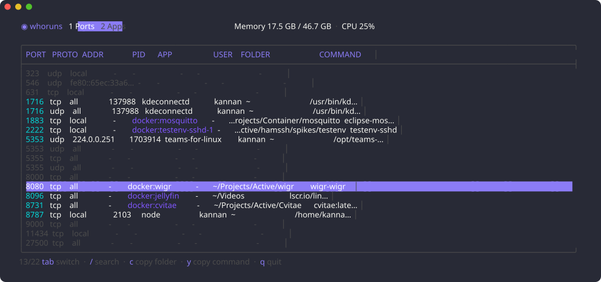
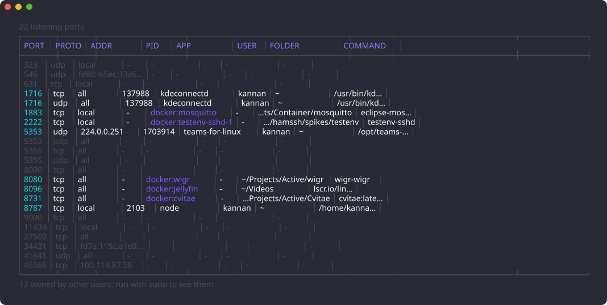
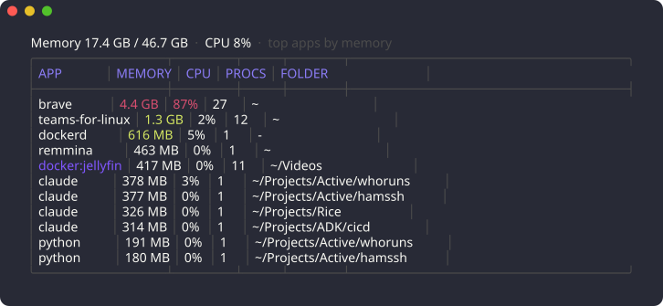

<div align="center">

# whoruns

**Find what's running, and where it lives.**

Every listening port, the process behind it, and the project folder it was started from.
One table. Linux, macOS and Windows. Docker aware.

[](https://github.com/kannan983/whoruns/releases/latest)
[](LICENSE)
[](go.mod)



</div>

## The problem

`Error: listen EADDRINUSE: address already in use :::3000`

Something holds port 3000. But what, and from which project? The usual tools each answer a piece:

| Tool | Gives you | Missing |
|---|---|---|
| `ss -tlnp` / `lsof -i` | a PID and a process name | which folder, which project |
| `netstat -ano` (Windows) | a PID | everything else; now go find it in `tasklist` |
| `docker ps` | container ports | the host side shows only `docker-proxy` |

So you chase PIDs through `/proc`, Task Manager and `docker inspect`, differently on every OS.

**whoruns** answers the whole question in one command, the same way everywhere:

```
PORT  APP              FOLDER                     COMMAND
3000  node             ~/Projects/Active/webapp   npm run dev
8081  java             /opt/tomcat/bin            java ... catalina start
5432  docker:db        ~/Projects/Active/api      postgres:16
```

And when the machine feels slow, `whoruns top` tells you *"brave is using 4.4 GB, 76% CPU and 9% GPU across 27 processes"*, not a wall of 200 PIDs.

## Install

**Linux and macOS**

```sh
curl -fsSL https://raw.githubusercontent.com/kannan983/whoruns/main/install.sh | sh
```

**Windows** (PowerShell)

```powershell
irm https://raw.githubusercontent.com/kannan983/whoruns/main/install.ps1 | iex
```

No Go toolchain needed: the scripts download the prebuilt binary from the [latest release](https://github.com/kannan983/whoruns/releases/latest), verify its SHA-256 checksum, and install it to `/usr/local/bin` (or `~/.local/bin` without sudo) / `%LOCALAPPDATA%\whoruns` (added to your PATH).
Pin a version with `WHORUNS_VERSION=v0.1.0`, or pick the folder with `WHORUNS_INSTALL_DIR=~/bin`.

**With Go**

```sh
go install github.com/kannan983/whoruns@latest
```

Or grab an archive from [Releases](https://github.com/kannan983/whoruns/releases).

## Usage

```
whoruns              listening ports (same as: whoruns ports)
whoruns 3000         only port 3000
whoruns top          apps using the most memory
whoruns top cpu      apps using the most CPU
whoruns top gpu      apps using the most GPU
whoruns --tui        live view with search and copy
whoruns --version    print the version
```

### Ports



### Top apps



Processes are grouped into apps: a child running the same program as its parent joins its row, so a browser's 27 processes are one line, while `node` started from two projects is two lines, each with its folder.

### Live TUI

`whoruns --tui` refreshes every 2 seconds.

| Key | Action |
|---|---|
| `tab` / `1` / `2` | switch between Ports and Apps |
| `/` | search across every column (`enter` keeps it, `esc` clears it) |
| `c` | copy the folder path |
| `y` | copy the full command (Ports) |
| `s` | sort Apps by memory, CPU or GPU |
| `j` `k` / arrows, `g` `G`, `pgup` `pgdn` | move |
| `q` | quit |

Copying uses OSC 52, so it works in modern terminals (Ghostty, kitty, WezTerm, iTerm2, Windows Terminal) and over SSH.

## How it works

- **Ports and processes** come from [gopsutil](https://github.com/shirou/gopsutil), which reads them natively on each OS.
- **Folder** is the process's working directory: the place it was started from, which is almost always the project.
- **Docker** ports are held by `docker-proxy`, which says nothing useful. whoruns asks `docker ps` instead and reads the Compose `working_dir` label, so you see `~/Projects/Active/api`, not `/`. Containers on host networking are matched through their cgroup (Linux).
- **Memory** on Linux is PSS, which splits shared memory fairly between processes, so multi-process apps such as browsers are not over-counted. Elsewhere it is RSS.
- **CPU** is a percentage of one core, like `top`, so busy apps can pass 100%.
- **GPU** on Linux comes from the kernel's per-client DRM counters (`/proc/<pid>/fdinfo`), the same source `nvtop` and `intel_gpu_top` use, so it works for Intel, AMD and other open drivers without root. An app's GPU % is its busiest engine (3D, video, copy...); GPU MEM is the memory it holds on the GPU, including buffers it shares with the compositor. NVIDIA's proprietary driver does not expose these counters, so whoruns reads `nvidia-smi pmon` instead (untested so far, reports welcome). Apps that never opened the GPU show `-`.

### Permissions

Without root, the OS hides the details of other users' processes (system services, root-owned daemons). Those rows are dimmed, and whoruns tells you how many. Run `sudo whoruns` (or an Administrator terminal on Windows) to see everything.

### Platform notes

| | Linux | macOS | Windows |
|---|---|---|---|
| Ports, process, user, command | ✓ | ✓ | ✓ |
| Folder | working directory | working directory | executable's folder (Windows does not expose another process's working directory) |
| Docker project folder | ✓ | ✓ (published ports) | ✓ (published ports) |
| Memory | PSS | RSS | RSS |
| GPU per app | Intel, AMD, others via DRM fdinfo; NVIDIA via `nvidia-smi` | - | NVIDIA via `nvidia-smi` |

Linux is where whoruns is developed and tested daily; macOS and Windows builds are produced by every release.

## Roadmap

- GPU per app on macOS and on Windows without NVIDIA

There may also be an easter egg or two. Who knows who runs the world.

## Author

**Kannan** · [kannan848@proton.me](mailto:kannan848@proton.me)

Built out of years of hunting down "who's on port 3000?" across Linux, macOS and Windows machines.

## License

[Apache License 2.0](LICENSE) © 2026 Kannan
